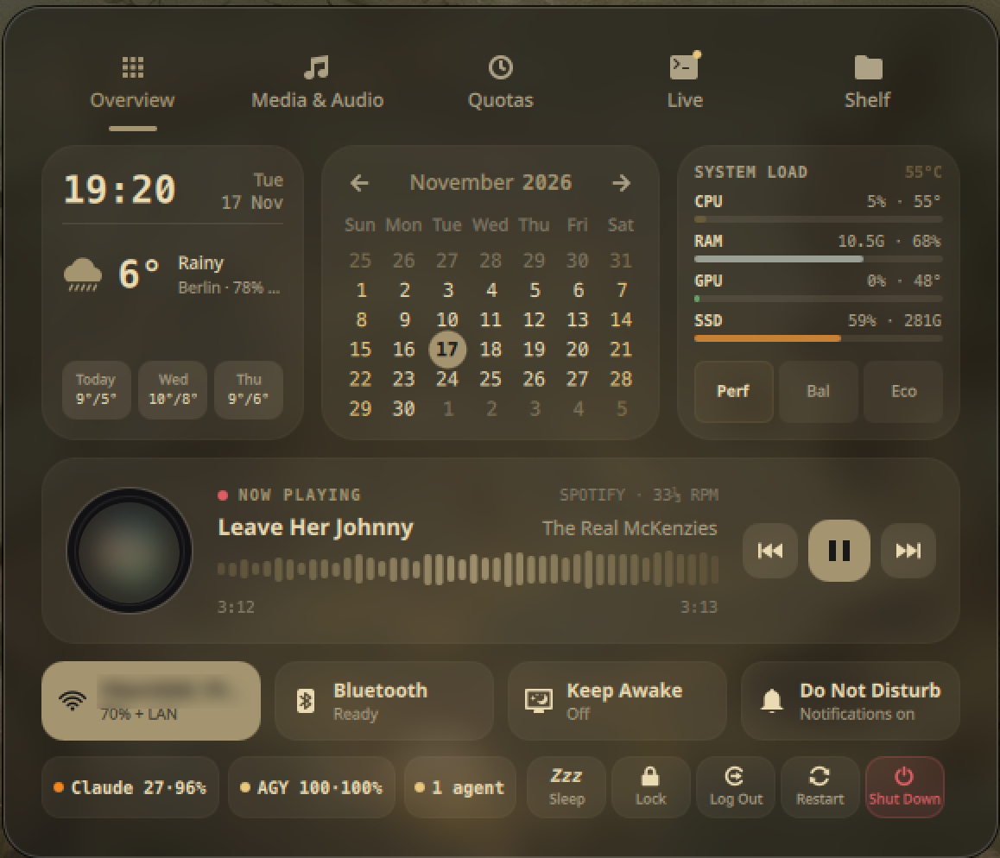
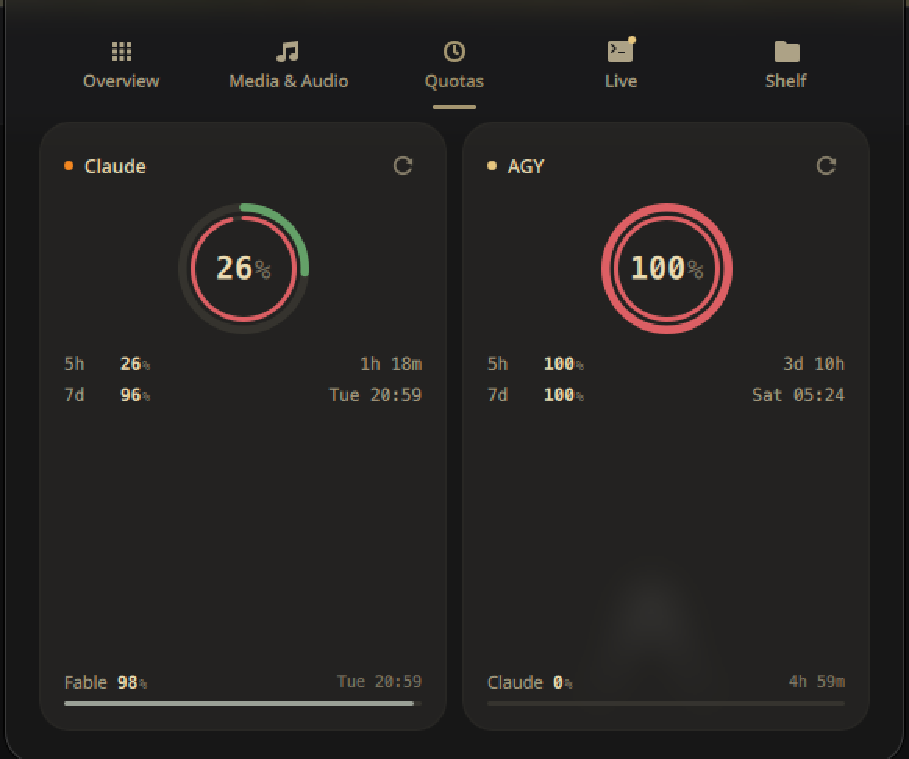
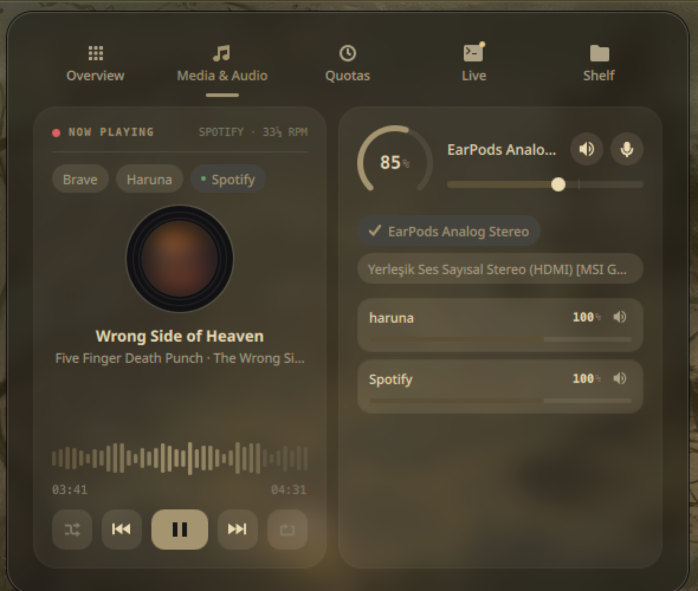

<p align="center">
  <picture>
    <source media="(prefers-color-scheme: dark)" srcset="docs/images/logo-dark.svg">
    
  </picture>
</p>

<p align="center">
  <b>A Dynamic Island–style KDE Plasma 6 panel widget for media, audio and AI subscription quotas.</b><br>
  It follows your system color scheme and expands into a small control center when clicked.
</p>

<div align="center">

[](https://github.com/fatihaydost/plasma-quota-island/releases/latest)
[](https://store.kde.org/p/2382079/)
[](https://kde.org/plasma-desktop/)
[](LICENSE)

</div>

<p align="center">
  <b>English</b> · <a href="README.tr.md">Türkçe</a>
</p>

<p align="center">
  
</p>

---

The widget sits in a Plasma panel. Collapsed, it shows the current track, the volume and one small ring per quota provider. Click it and a popup opens with five tabs: **Overview**, **Media & Audio**, **Quotas**, **Live** and **Shelf**. The interface is available in English and Turkish.

The quota rings read the usage limits of Claude, Antigravity (AGY) and ChatGPT/Codex subscriptions from the credentials their own command-line tools already store on your machine. Providers without credentials stay hidden.

> [!WARNING]
> **Quota data comes from unofficial, internal endpoints.** None of the providers documents or supports these endpoints, and they can change or stop working at any time. When that happens, the affected card shows no data. This project is not affiliated with Anthropic, Google or OpenAI. Dynamic Island is a trademark of Apple Inc.; this project is not affiliated with Apple.

## Features

<p align="center">
  <br>
  <sub>Weather is off by default; in this screenshot it is set to a manual location (Berlin).</sub>
</p>

- **Panel capsule.** Shows the track, a volume ring and the quota rings. While media is playing it adds cover art, animated bars and previous/play/next buttons. Volume changes, track changes and Herdr agents waiting for approval briefly show a notice in the capsule. A microphone icon appears while an application is recording; its tooltip names the application. This uses Plasma's own volume module and stays off if the module is not available.
- **Overview.** Clock and optional weather, a calendar, CPU/RAM/GPU/disk load, the power profile, a media card, quick toggles (Wi-Fi, Bluetooth, keep awake, do not disturb), quota chips and a power strip (sleep, lock, log out, restart, shut down). Every power action except lock needs a second click within four seconds.
- **Media & Audio.** Picks an MPRIS player, shows cover art, seeks through a clickable progress bar and controls playback, including shuffle and repeat (off, playlist, track) when the player supports them. It sets the output volume from 0 to 150%, mutes the speaker and the microphone, switches the output device and sets the volume of each playing application.
- **Quotas.** One card per provider with the 5-hour and 7-day windows, usage percentage and reset time. Claude also shows the weekly Fable limit when the account has one. AGY shows its Gemini and Claude pools. Codex support is experimental (see [Quota providers](#quota-providers)).
- **Live.** Herdr agents (working, waiting for approval, done; click an agent to focus its terminal), today's Houra focus summary, the power profile, battery and the connected Bluetooth device. Every card is hidden when its tool is missing.
- **Shelf.** Drop files, folders, links or text onto the capsule or the popup to pin them. Each item can be opened, copied or removed.

<p align="center">
  
  
</p>

## Quota providers

Each provider can be turned on or off in the widget settings. A provider is shown only when it is turned on **and** its credentials are found. When no provider is shown, the quotas tab and the panel rings are hidden too. A provider that is turned off is never queried.

| Provider | Credentials read (locally, in memory) | Windows |
|---|---|---|
| Claude | `~/.claude/.credentials.json` (Claude Code login). If the live request fails, the usage snapshot in `~/.claude.json` is used. | 5 hours, 7 days, weekly Fable limit |
| AGY (Antigravity) | libsecret entry `service=gemini`, `username=antigravity` (Antigravity login) | Gemini 5-hour pool, Claude 5-hour pool, weekly |
| ChatGPT / Codex (experimental) | `$CODEX_HOME/auth.json`, default `~/.codex/auth.json` (Codex CLI login). Credentials kept in the system keyring are **not** supported. | 5 hours, weekly |

Tokens are never written to disk, logs or the cache. Results are cached for 90 seconds in `~/.cache/plasma-quota-island/quotas_cache.json` (mode `0600`). If an endpoint is temporarily unreachable, the last live result is shown for up to 30 minutes, drawn faded and labelled `cached · N min ago`. Older data, or data whose window has already reset, is not shown.

The Codex endpoint and response format were taken from the open-source [openai/codex](https://github.com/openai/codex) client. They have not yet been checked against a live account.

## Privacy and network

The widget only makes the network requests listed here. Everything else (media, audio, Herdr, Houra, power, battery, Bluetooth, network status, the shelf) runs locally through D-Bus and command-line tools.

| Request | When | What is sent |
|---|---|---|
| `GET https://api.anthropic.com/api/oauth/usage` | Claude turned on and logged in: at startup, every 3 minutes, when the quotas tab opens, on the refresh button | Your Claude OAuth token |
| `POST https://daily-cloudcode-pa.googleapis.com/v1internal:fetchAvailableModels` and `:retrieveUserQuotaSummary` | Same schedule, AGY turned on and logged in | Your Antigravity OAuth token |
| `GET https://chatgpt.com/backend-api/wham/usage` | Same schedule, Codex turned on and logged in | Your Codex access token and ChatGPT account id |
| `GET https://api.open-meteo.com/v1/forecast` | Weather set to *manual* or *IP*: about every 15 minutes | Latitude and longitude |
| `GET https://geocoding-api.open-meteo.com/v1/search` | Weather set to *manual* with a city name and no coordinates; cached for 12 hours | The city name |
| `GET https://ipwho.is/` | Only when weather is set to *IP location*; cached for 12 hours | Your IP address (implicit in the request) |
| Cover art `https://` URLs | When a player reports an `https://` cover image | Whatever the player's URL contains |

Weather is **off** by default. In that mode no weather or location request is made. IP location is used only when you choose it in the settings.

**User-Agent.** Claude requests use this project's own User-Agent (verified working 2026-11-17); AGY and Codex currently send their official client's User-Agent because an honest one could not be tested. Weather requests also use this project's own User-Agent (`plasma-quota-island/1.0`). Turn a provider off if you do not want its requests to carry an official client's User-Agent.

## Optional integrations

These features are detected at runtime. If the tool is missing, its card, chip or panel notice is hidden; nothing else breaks.

| Integration | Needs | Used for |
|---|---|---|
| Herdr | `hc`, `herdr-app` | Agent list and approval notices; can also be turned off in the settings |
| [Houra](https://github.com/fatihaydost/houra-linux) | `~/.local/share/houra/houra.sqlite` (read-only) | Today's focus summary; can also be turned off in the settings |
| power-profiles-daemon | `powerprofilesctl` | Power profile switch |
| UPower | `upower` | Battery |
| BlueZ | `bluetoothctl` | Bluetooth toggle and device |
| NetworkManager | `nmcli` | Wi-Fi toggle and network status |
| Clipboard | `wl-copy` or `xclip` | Copying shelf items |

## Requirements

- KDE Plasma 6 (`plasmashell`, `kpackagetool6`)
- Python 3.10 or newer at `/usr/bin/python3` (the widget calls this path directly)
- PyGObject (`python-gobject`) for media control and the AGY keyring lookup
- PipeWire (`wpctl`) or PulseAudio (`pactl`) for audio
- An MPRIS-capable player for media (browsers, Spotify, VLC and others)

## Installation

```bash
git clone https://github.com/fatihaydost/plasma-quota-island.git
cd plasma-quota-island
./install.sh
```

The script checks for `kpackagetool6` and `/usr/bin/python3`, lists any optional tools that are missing, and installs or upgrades the widget. Then right-click the panel, choose **Add Widgets…** and add **Quota Island**.

If the widget is already in the panel, restart the shell after an upgrade so the new QML is loaded:

```bash
./install.sh --reload
```

### Uninstall

```bash
./install.sh --remove
```

This removes the widget package. The cache and shelf data stay in `~/.cache/plasma-quota-island`; delete that folder to remove them as well.

## Configuration

Right-click the widget and open its settings. There are two pages.

The interface follows the Plasma system language (English, Turkish).

**General**

- **Color theme:** *System color scheme (KDE)* (default) or *Gruvbox Dark*, and an optional custom accent color.
- **Max. track title width** and **Wheel volume step** for the panel capsule.
- **Panel badges:** show the volume percentage badge and the quota rings.
- **Idle quota badge:** which window the numbers next to each panel ring show: *Hourly and weekly together (5h·7d)* (default), *Hourly window only (5h)* or *Weekly window only (7d)*.
- **Quota providers:** Claude, Antigravity (AGY) and ChatGPT / Codex, each on or off.
- **Optional integrations:** Herdr agents and the Houra focus summary.
- **Weather:** *Off (no network requests)*, *Manual location (Open-Meteo)* with a city or coordinates, or *Locate me by IP address*.

**Diagnostics**

Shows whether each tool the widget can use is found: audio (`wpctl`, `pactl`), system (`powerprofilesctl`, `upower`, `bluetoothctl`, `nmcli`), optional integrations (`hc`, `herdr-app`, the Houra database) and the quota credentials of each provider. It checks presence only; no paths, tokens or credential contents are read into the page. Use *Check again* after installing a tool.

## Usage

**On the panel capsule**

- Left click: open or close the popup.
- Mouse wheel: change the volume.
- Middle click: mute or unmute the output.
- Drag and drop: pin a file, link or text to the shelf and open the popup.

**In the popup**

- `Tab` / `Shift+Tab`: move between tabs, buttons, sliders and list rows.
- `Left` / `Right`: switch tabs in the tab bar; change the value of a slider.
- `Enter` / `Space`: activate the focused item.
- `Esc`: close the popup.

## Development

```bash
python3 -m unittest discover -s tests -v
/usr/lib/qt6/bin/qmllint -I /usr/lib/qt6/qml package/contents/ui/*.qml
```

Use the Qt 6 `qmllint` at `/usr/lib/qt6/bin/`; `/usr/bin/qmllint` may be the Qt 5 version. It reports `Unqualified access` warnings for every `i18n()`, `i18nc()` and `i18np()` call. This is expected: Plasma injects these functions at runtime, and qmllint still exits with 0.

Translations live in `translate/`. After changing interface text, run `translate/build.sh` to update `template.pot`, merge the `.po` files and compile them into `package/contents/locale/`.

## License

[GPL-3.0-or-later](LICENSE).
