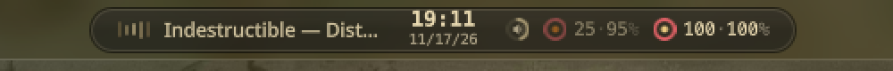
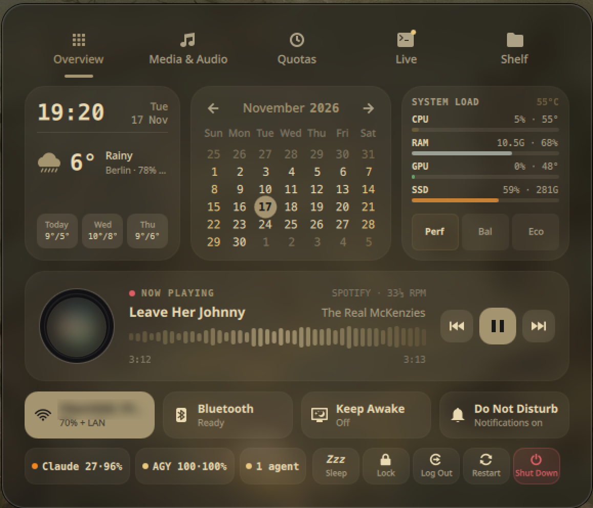
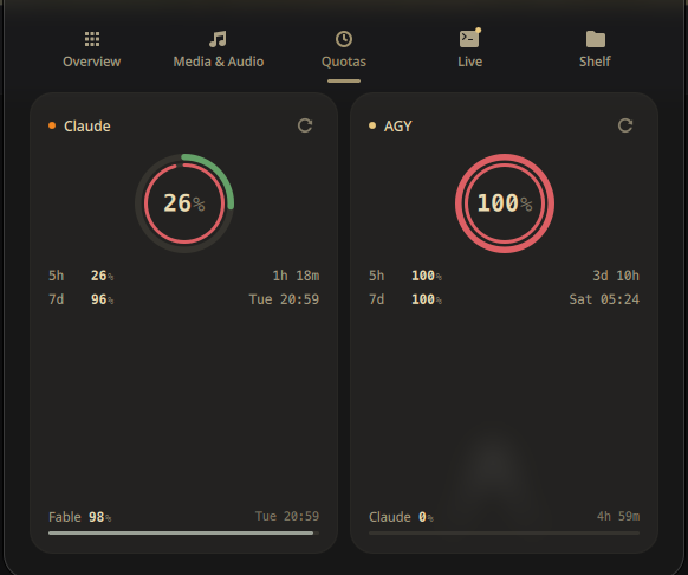
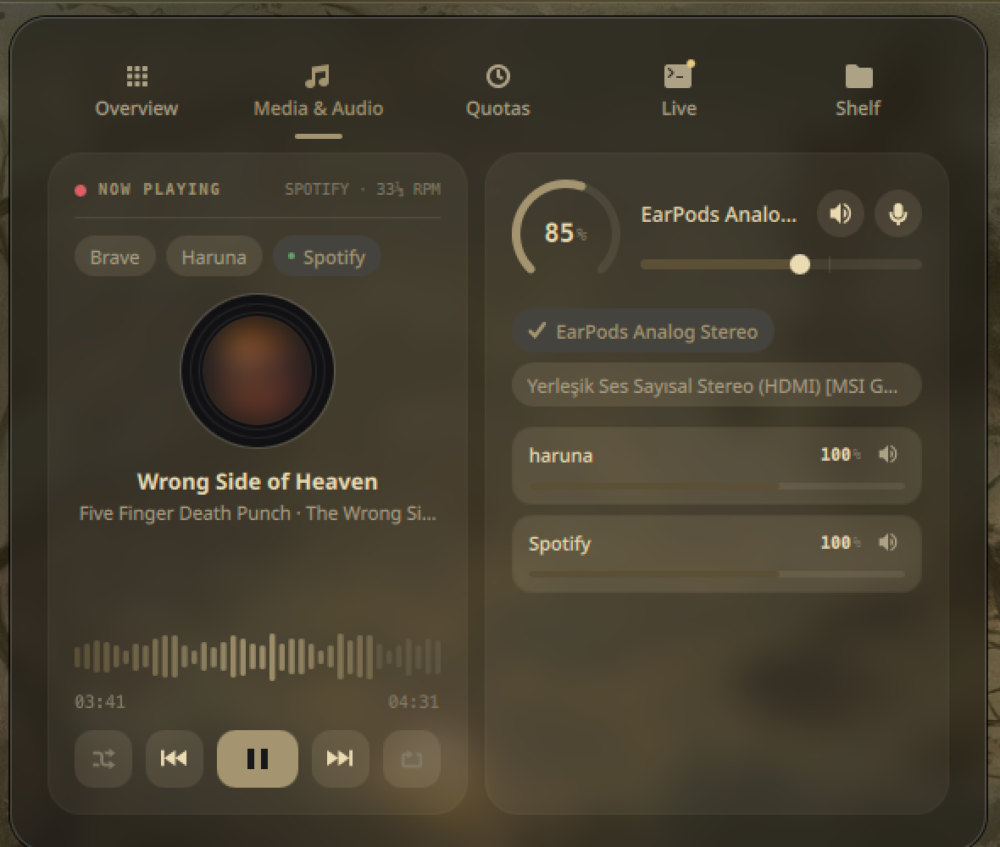

<p align="center">
  <picture>
    <source media="(prefers-color-scheme: dark)" srcset="docs/images/logo-dark.svg">
    
  </picture>
</p>

<p align="center">
  <b>Medya, ses ve yapay zekâ abonelik kotaları için Dynamic Island tarzı bir KDE Plasma 6 panel widget'ı.</b><br>
  Sistem renk şemanıza uyar, tıklayınca küçük bir kontrol merkezine açılır.
</p>

<div align="center">

[](https://github.com/fatihaydost/plasma-quota-island/releases/latest)
[](https://store.kde.org/p/2382079/)
[](https://kde.org/plasma-desktop/)
[](LICENSE)

</div>

<p align="center">
  <a href="README.md">English</a> · <b>Türkçe</b>
</p>

<p align="center">
  
</p>

---

Widget bir Plasma panelinde durur. Kapalıyken çalan parçayı, ses düzeyini ve her kota sağlayıcısı için küçük bir halkayı gösterir. Tıkladığınızda beş sekmeli bir pencere açılır: **Panel**, **Medya & Ses**, **Kotalar**, **Canlı** ve **Raf**. Arayüz İngilizce ve Türkçe kullanılabilir.

Kota halkaları Claude, Antigravity (AGY) ve ChatGPT/Codex aboneliklerinin kullanım sınırlarını okur. Bunun için bu araçların komut satırı istemcilerinin bilgisayarınızda zaten sakladığı kimlik bilgilerini kullanır. Kimlik bilgisi bulunmayan sağlayıcı hiç görünmez.

> [!WARNING]
> **Kota verisi resmî olmayan, dahili uç noktalardan okunur.** Sağlayıcıların hiçbiri bu uçları belgelemiyor ya da desteklemiyor; her an değişebilir veya çalışmayı bırakabilirler. O durumda ilgili kart veri göstermez. Bu projenin Anthropic, Google ya da OpenAI ile bağlantısı yoktur. Dynamic Island, Apple Inc.'in ticari markasıdır; projenin Apple ile de bağlantısı yoktur.

## Özellikler

<p align="center">
  <br>
  <sub>Hava durumu varsayılan olarak kapalıdır; bu görüntüde elle konum (Berlin) seçilmiştir.</sub>
</p>

- **Panel kapsülü.** Parçayı, ses halkasını ve kota halkalarını gösterir. Medya çalarken kapak görseli, hareketli çubuklar ve önceki/oynat/sonraki düğmeleri eklenir. Ses düzeyi ya da parça değişince, bir Herdr ajanı onay beklemeye başlayınca kapsülde kısa bir bildirim belirir. Bir uygulama mikrofonu kullanırken mikrofon simgesi görünür, ipucunda uygulamanın adı yazar. Bu gösterge Plasma'nın kendi ses modülünü kullanır; modül yoksa kapalı kalır.
- **Panel.** Saat ve isteğe bağlı hava durumu, takvim, CPU/RAM/GPU/disk yükü, güç profili, medya kartı, hızlı geçişler (Wi-Fi, Bluetooth, uyanık tut, rahatsız etme), kota çipleri ve güç şeridi (uyku, kilitle, oturumu kapat, yeniden başlat, kapat). Kilitle dışındaki her güç eylemi dört saniye içinde ikinci bir tıklama ister.
- **Medya & Ses.** MPRIS oynatıcısını seçer, kapak görselini gösterir, tıklanabilir ilerleme çubuğuyla konum değiştirir ve oynatmayı yönetir. Oynatıcı destekliyorsa karıştırma ve tekrarlama (kapalı, liste, parça) da buradadır. Çıkış sesini %0 ile %150 arasında ayarlar, hoparlörü ve mikrofonu sessize alır, çıkış cihazını değiştirir, ses çalan her uygulamanın düzeyini ayrı ayarlar.
- **Kotalar.** Her sağlayıcı için bir kart: 5 saatlik ve 7 günlük pencere, kullanım yüzdesi ve sıfırlanma zamanı. Hesapta varsa Claude kartı haftalık Fable sınırını da gösterir. AGY kartında Gemini ve Claude havuzları yer alır. Codex desteği deneyseldir ([Kota sağlayıcıları](#kota-sağlayıcıları) bölümüne bakın).
- **Canlı.** Herdr ajanları (çalışan, onay bekleyen, biten; bir ajana tıklayınca terminaline geçilir), bugünkü Houra odak özeti, güç profili, pil ve bağlı Bluetooth cihazı. Aracı bulunmayan kart gizlenir.
- **Raf.** Dosya, klasör, bağlantı ya da metni kapsülün veya pencerenin üstüne bırakarak rafa sabitleyin. Her öğe açılabilir, kopyalanabilir ya da kaldırılabilir.

<p align="center">
  
  
</p>

## Kota sağlayıcıları

Her sağlayıcıyı widget ayarlarından ayrı ayrı açıp kapatabilirsiniz. Bir sağlayıcı yalnız açıksa **ve** kimlik bilgisi bulunduysa görünür. Hiçbir sağlayıcı görünmüyorsa kotalar sekmesi ve panel halkaları da gizlenir. Kapalı sağlayıcıya hiç istek gönderilmez.

| Sağlayıcı | Okunan kimlik bilgisi (yerelde, yalnız bellekte) | Pencereler |
|---|---|---|
| Claude | `~/.claude/.credentials.json` (Claude Code girişi). Canlı istek başarısız olursa `~/.claude.json` içindeki kullanım özeti kullanılır. | 5 saat, 7 gün, haftalık Fable sınırı |
| AGY (Antigravity) | libsecret kaydı `service=gemini`, `username=antigravity` (Antigravity girişi) | Gemini 5 saatlik havuz, Claude 5 saatlik havuz, haftalık |
| ChatGPT / Codex (deneysel) | `$CODEX_HOME/auth.json`, varsayılan `~/.codex/auth.json` (Codex CLI girişi). Sistem anahtarlığında saklanan kimlik bilgileri **desteklenmez**. | 5 saat, haftalık |

Token'lar diske, günlüklere ya da önbelleğe hiç yazılmaz. Sonuçlar 90 saniye boyunca `~/.cache/plasma-quota-island/quotas_cache.json` dosyasında (izin `0600`) tutulur. Bir uç geçici olarak erişilemezse son canlı sonuç en fazla 30 dakika gösterilir; soluk çizilir ve yanında `önbellek · N dk önce` notu çıkar. Daha eski veri ya da penceresi sıfırlanmış veri gösterilmez.

Codex uç noktası ve yanıt biçimi açık kaynak [openai/codex](https://github.com/openai/codex) istemcisinden alındı. Henüz gerçek bir hesapla denenmedi.

## Gizlilik ve ağ

Widget yalnız aşağıdaki ağ isteklerini yapar. Geri kalan her şey (medya, ses, Herdr, Houra, güç, pil, Bluetooth, ağ durumu, raf) D-Bus ve komut satırı araçlarıyla yerelde çalışır.

| İstek | Ne zaman | Ne gönderilir |
|---|---|---|
| `GET https://api.anthropic.com/api/oauth/usage` | Claude açık ve giriş yapılmışsa: açılışta, 3 dakikada bir, kotalar sekmesi açılınca, yenile düğmesiyle | Claude OAuth token'ınız |
| `POST https://daily-cloudcode-pa.googleapis.com/v1internal:fetchAvailableModels` ve `:retrieveUserQuotaSummary` | Aynı takvim, AGY açık ve giriş yapılmışsa | Antigravity OAuth token'ınız |
| `GET https://chatgpt.com/backend-api/wham/usage` | Aynı takvim, Codex açık ve giriş yapılmışsa | Codex erişim token'ınız ve ChatGPT hesap kimliğiniz |
| `GET https://api.open-meteo.com/v1/forecast` | Hava durumu *elle* ya da *IP* kipindeyse: yaklaşık 15 dakikada bir | Enlem ve boylam |
| `GET https://geocoding-api.open-meteo.com/v1/search` | Hava durumu *elle* kipinde, şehir adı girilmiş ve koordinat boşsa; 12 saat önbellekte tutulur | Şehir adı |
| `GET https://ipwho.is/` | Yalnız hava durumu *IP konumu* kipindeyse; 12 saat önbellekte tutulur | IP adresiniz (isteğin kendisinde) |
| Kapak görseli `https://` adresleri | Bir oynatıcı `https://` kapak görseli bildirdiğinde | Oynatıcının verdiği adres |

Hava durumu varsayılan olarak **kapalıdır**; bu kipte hava ya da konum isteği yapılmaz. IP konumu yalnız ayarlarda siz seçerseniz kullanılır.

**User-Agent.** Claude istekleri bu projenin kendi User-Agent'ını kullanır (2026-11-17'de çalıştığı doğrulandı); AGY ve Codex ise dürüst bir User-Agent denenemediği için şimdilik resmî istemcilerinin User-Agent'ını gönderir. Hava durumu istekleri de projenin kendi User-Agent'ını (`plasma-quota-island/1.0`) kullanır. İsteklerinin resmî istemci User-Agent'ı taşımasını istemiyorsanız ilgili sağlayıcıyı kapatın.

## İsteğe bağlı entegrasyonlar

Bu özellikler çalışma anında algılanır. Araç yoksa ilgili kart, çip ya da panel bildirimi gizlenir, başka hiçbir şey bozulmaz.

| Entegrasyon | Gereken | Kullanım |
|---|---|---|
| Herdr | `hc`, `herdr-app` | Ajan listesi ve onay bildirimleri; ayarlardan da kapatılabilir |
| [Houra](https://github.com/fatihaydost/houra-linux) | `~/.local/share/houra/houra.sqlite` (salt okunur) | Bugünkü odak özeti; ayarlardan da kapatılabilir |
| power-profiles-daemon | `powerprofilesctl` | Güç profili geçişi |
| UPower | `upower` | Pil |
| BlueZ | `bluetoothctl` | Bluetooth geçişi ve cihaz |
| NetworkManager | `nmcli` | Wi-Fi geçişi ve ağ durumu |
| Pano | `wl-copy` ya da `xclip` | Raf öğelerini kopyalama |

## Gereksinimler

- KDE Plasma 6 (`plasmashell`, `kpackagetool6`)
- `/usr/bin/python3` yolunda Python 3.10 ya da üstü (widget bu yolu doğrudan çağırır)
- Medya denetimi ve AGY anahtarlık okuması için PyGObject (`python-gobject`)
- Ses için PipeWire (`wpctl`) ya da PulseAudio (`pactl`)
- Medya için MPRIS destekli bir oynatıcı (tarayıcılar, Spotify, VLC ve diğerleri)

## Kurulum

```bash
git clone https://github.com/fatihaydost/plasma-quota-island.git
cd plasma-quota-island
./install.sh
```

Betik `kpackagetool6` ve `/usr/bin/python3` varlığını denetler, eksik isteğe bağlı araçları listeler, sonra widget'ı kurar ya da günceller. Ardından panele sağ tıklayın, **Araç Takımları Ekle...** menüsünden **Quota Island** öğesini ekleyin.

Widget zaten paneldeyse güncellemeden sonra yeni QML'in yüklenmesi için kabuğu yeniden başlatın:

```bash
./install.sh --reload
```

### Kaldırma

```bash
./install.sh --remove
```

Bu komut widget paketini kaldırır. Önbellek ve raf verisi `~/.cache/plasma-quota-island` dizininde kalır; onları da silmek için bu dizini kaldırın.

## Yapılandırma

Widget'a sağ tıklayıp ayarlarını açın. İki sayfa var.

Arayüz, Plasma'nın sistem dilini izler (İngilizce, Türkçe).

**Genel**

- **Renk teması:** *Sistem renk şeması (KDE)* (varsayılan) ya da *Gruvbox Dark*, isteğe bağlı özel vurgu rengiyle.
- Panel kapsülü için **Maks. şarkı adı genişliği** ve **Tekerlek ses adımı**.
- **Panel rozetleri:** ses yüzdesi rozeti ve kota halkaları.
- **Boştayken kota rozeti:** paneldeki her halkanın yanındaki sayıların hangi pencereyi gösterdiği: *Saatlik ve haftalık birlikte (5sa·7g)* (varsayılan), *Yalnız saatlik pencere (5sa)* ya da *Yalnız haftalık pencere (7g)*.
- **Kota sağlayıcıları:** Claude, Antigravity (AGY) ve ChatGPT / Codex, her biri ayrı açılıp kapatılır.
- **İsteğe bağlı entegrasyonlar:** Herdr ajanları ve Houra odak özeti.
- **Hava durumu:** *Kapalı (ağ isteği yok)*, şehir ya da koordinatla *Elle konum (Open-Meteo)*, ya da *IP adresimden konum bul*.

**Teşhis**

Widget'ın kullanabileceği her aracın bulunup bulunmadığını gösterir: ses (`wpctl`, `pactl`), sistem (`powerprofilesctl`, `upower`, `bluetoothctl`, `nmcli`), isteğe bağlı entegrasyonlar (`hc`, `herdr-app`, Houra veritabanı) ve her sağlayıcının kota kimlik bilgisi. Yalnız varlığa bakar; sayfaya hiçbir yol, token ya da kimlik içeriği okunmaz. Bir araç kurduktan sonra *Yeniden denetle* düğmesine basın.

## Kullanım

**Panel kapsülünde**

- Sol tık: pencereyi açar ya da kapatır.
- Fare tekerleği: ses düzeyini değiştirir.
- Orta tık: çıkışı sessize alır ya da sesi açar.
- Sürükle bırak: dosya, bağlantı ya da metni rafa sabitler ve pencereyi açar.

**Açılır pencerede**

- `Tab` / `Shift+Tab`: sekmeler, düğmeler, kaydırıcılar ve liste satırları arasında dolaşır.
- `Sol` / `Sağ`: sekme çubuğunda sekme değiştirir, kaydırıcıda değeri ayarlar.
- `Enter` / `Space`: odaktaki öğeyi etkinleştirir.
- `Esc`: pencereyi kapatır.

## Geliştirme

```bash
python3 -m unittest discover -s tests -v
/usr/lib/qt6/bin/qmllint -I /usr/lib/qt6/qml package/contents/ui/*.qml
```

`/usr/lib/qt6/bin/` altındaki Qt 6 `qmllint`'i kullanın; `/usr/bin/qmllint` Qt 5 sürümü olabilir. Her `i18n()`, `i18nc()` ve `i18np()` çağrısı için `Unqualified access` uyarısı verir. Bu beklenen bir durum: Plasma bu işlevleri çalışma anında ekler, qmllint de yine 0 ile çıkar.

Çeviriler `translate/` dizinindedir. Arayüz metnini değiştirdikten sonra `translate/build.sh` betiğini çalıştırın: `template.pot` güncellenir, `.po` dosyaları birleştirilir ve `package/contents/locale/` altına derlenir.

## Lisans

[GPL-3.0-or-later](LICENSE).
